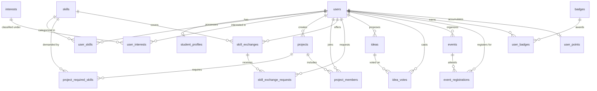

# 🎓 Campus Nexus — Student Collaboration Hub
### *Student Innovation & Campus Teaming Network*

[](https://www.php.net/)
[](https://www.mysql.com/)
[](https://developer.mozilla.org/en-US/docs/Web/CSS)
[](LICENSE)

> **"Your Campus. Your Ideas. Your Future."**  
> An all-in-one, full-stack student collaboration platform engineered to break down academic silos across departments. Campus Nexus bridges project matchmaking, peer skill exchanges, campus proposals, event registration, and gamified achievement recognition.

---

## 📌 Table of Contents
- [Problem Statement & Solution](#-problem-statement--solution)
- [Key Features & Modules](#-key-features--modules)
- [Design Aesthetics & Visual Identity](#-design-aesthetics--visual-identity)
- [Technology Stack](#-technology-stack)
- [Database Schema & Architecture](#-database-schema--architecture)
- [Project Directory Structure](#-project-directory-structure)
- [Installation & Local Setup](#-installation--local-setup)
- [Security Implementation](#-security-implementation)
- [Manual Testing Checklist](#-manual-testing-checklist)
- [Git Repository Setup Guide](#-git-repository-setup-guide)
- [Known Limitations & Future Roadmap](#-known-limitations--future-roadmap)

---

## 💡 Problem Statement & Solution

### The Fragmented Campus Problem
In universities and colleges today, student collaboration is notoriously scattered across disjointed WhatsApp groups, Discord servers, buried Slack channels, and physical notice boards. Students with technical skills lack avenues to teach peers; innovators struggle to discover complementary teammates for hackathons; and campus workshops suffer from unorganized registration workflows.

### The Nexus Solution
**Campus Nexus** unifies student academic and extracurricular life into a single cohesive, high-performance web platform:
1. **Algorithmic Team Finder:** Calculates real-time skill-compatibility percentages between prospective teammates and project requirements.
2. **Peer Skill Marketplace:** Enables students to offer mentorship in specific technologies and exchange requests with fellow peers.
3. **Open Idea Board:** A democratic student proposal forum with vote tracking, category filters, and anti-self-vote server guards.
4. **Interactive Event Discovery:** Campus workshop discovery with real-time seat availability countdowns, registration caps, and status badges.
5. **Idempotent Gamification:** Action-triggered points and achievement badges, complete with a campus leaderboard and podium spotlight.

---

## 🚀 Key Features & Modules

### 1. Animated Landing Page (`public/index.php`)
- **Cosmic Space Hero:** Deep cosmic navy canvas (`#070a13`), atmospheric planetary radial glows, glowing typography, and floating interactive preview cards.
- **Problem vs. Solution Matrix:** Compares fragmented college communication with the structured Nexus workflow.
- **Interactive Match Simulator:** Live visual demonstration showing how skill-compatibility scores are computed.
- **Workflow & Gamification Teasers:** Visual previews of the 4-step collaboration loop and unlockable badges.

### 2. High-Density Unified Dashboard (`public/dashboard.php`)
- **Aggregated Metric Cards:** 8 real-time student statistics computed in a single optimized relational query:
  - Total Points ⭐
  - Badges Unlocked 🏆
  - Projects Created & Joined 🚀
  - Pending Incoming Team Requests 📬
  - Skill Offers & Requests 🤝
  - Registered Upcoming Events 📅
- **Quick-Action Panel:** One-click shortcuts to launch projects, post ideas, offer skills, or browse events.

### 3. Student Profile & Skill Matrix (`modules/students/`)
- **Academic Profile Management:** Department, semester, bio, and student initials avatar.
- **Skill Proficiency Tracker:** Categorized skill tagging (`Web Development`, `Programming`, `Database`, `Design`, `Security`) with proficiency levels (`Beginner`, `Intermediate`, `Advanced`, `Expert`) backed by `ON DUPLICATE KEY UPDATE` queries.
- **Interests Matrix:** Transaction-guarded multi-select interest chips for personalized discovery.

### 4. Team Finder & Matchmaking (`modules/projects/`)
- **Compatibility Scoring:** Evaluates the student's logged skills against project required skills:
  $$\text{Match } \% = \left(\frac{\text{Matching Skills Count}}{\text{Total Required Skills Count}}\right) \times 100$$
- **Request Lifecycle:** Students can request to join teams; project owners can review applicants, inspect their matched skills, and accept or reject with idempotent database transactions.

### 5. Peer Skill Exchange (`modules/skills/`)
- **Skill Offerings:** Students publish topics they are willing to teach or mentor.
- **Mentorship Requests:** Other students can request 1-on-1 assistance with custom messages.
- **Ownership Security:** Students cannot request help on their own offers; only the offering owner can accept/reject.

### 6. Campus Idea Board (`modules/ideas/`)
- **Democratic Proposals:** Students pitch projects, campus initiatives, and research ideas.
- **Search & Sort:** Filter proposals by search query, category, vote count (Most Popular), or creation date (Newest).
- **Anti-Tamper Voting:** Server-side verification preventing double-voting and self-voting on owned ideas.

### 7. Campus Events Discovery (`modules/events/`)
- **Live Seat Tracking:** Real-time remaining seats calculation (`max_participants - registered_count`).
- **Capacity Integrity:** Transactional concurrency checks prevent over-booking past event capacity.
- **Status Classification:** Automatic labeling of events as `Upcoming`, `Ongoing`, `Full`, or `Cancelled`.

### 8. Gamification & Leaderboard (`modules/gamification/`)
- **Verifiable Badges:** `First Project`, `Team Builder`, `Skill Sharer`, `Idea Contributor`, and `Event Explorer`.
- **Top 3 Podium Spotlight:** Visual gold (🥇), silver (🥈), and bronze (🥉) rankings highlighting top student contributors.
- **Inclusive Leaderboard:** Full campus standings including students starting with zero points.

---

## 🎨 Design Aesthetics & Visual Identity

Campus Nexus employs a cohesive synthesis of modern web aesthetics:
- **Cinematic Deep Navy:** (`--cosmic-950: #070a13`, `--cosmic-900: #0b1120`) creates high-contrast depth for hero and dark accents.
- **Warm Pastel Peach & Cream:** (`--surface-cream: #fcfaf6`, `--peach-500: #f97316`) provides an inviting, accessible educational feel across content cards and forms.
- **Modern Clean Slate:** (`--background: #f8fafc`, `--surface: #ffffff`) ensures optimal readability and data density in dashboard views.
- **Typography:** Google Fonts pairing of **Plus Jakarta Sans** (clean, legible body copy) and **Space Grotesk** (tech-forward display headings).
- **Micro-Interactions:** Pure CSS subtle hover elevations, smooth transitions (`cubic-bezier(0.16, 1, 0.3, 1)`), and native `IntersectionObserver` scroll reveals.
- **Accessibility:** Full keyboard navigability, clear focus rings (`0 0 0 3px rgba(79, 70, 229, 0.18)`), and complete respect for `@media (prefers-reduced-motion: reduce)`.

---

## 🛠 Technology Stack

| Layer | Technology | Details |
|---|---|---|
| **Backend Runtime** | PHP 8.0+ | Native PHP without heavy frameworks; clean procedural/modular OOP architecture. |
| **Database** | MySQL 8.0+ / MariaDB | Relational InnoDB storage engine, foreign keys, cascading deletes, unique constraints. |
| **Frontend Structure** | HTML5 | Semantic markup (`<main>`, `<nav>`, `<article>`, `<section>`, `<header>`, `<footer>`). |
| **Frontend Styling** | Vanilla CSS3 | Custom Properties (CSS variables), CSS Grid, Flexbox, zero Tailwind/Bootstrap dependencies. |
| **Client Scripting** | Vanilla JavaScript (ES6+) | No jQuery or React; native DOM manipulation, ARIA attributes, and `IntersectionObserver`. |
| **Session & Auth** | PHP Native Sessions | Cookie security flags, session fixation protection, flash message bus. |
| **Server Compatibility** | Apache / Nginx / XAMPP | Dynamic `$baseUrl` resolution; supports root or arbitrary nested subfolder hosting. |

---

## 🗄 Database Schema & Architecture

The system database is named `campus_nexus` and consists of **18 interconnected relational tables**:



### Table Summary:
1. `users` — Student accounts, email, role (`student`, `admin`), `last_login_at`, and password hashes.
2. `student_profiles` — Academic metadata (department, semester, `roll_number`, bio, avatar).
3. `skills` — Standardized skill taxonomy with categories.
4. `user_skills` — Pivot table storing student skills and proficiency rankings.
5. `interests` — Catalog of student interest domains.
6. `user_interests` — Pivot table mapping users to interest tags.
7. `projects` — Student collaboration projects with status flags (`open`, `in_progress`, `completed`).
8. `project_required_skills` — Required technologies for algorithmic team compatibility.
9. `project_members` — Team membership applications and approval status (`pending`, `accepted`, `rejected`).
10. `skill_exchanges` — Peer teaching offerings.
11. `skill_exchange_requests` — Peer mentorship applications with status.
12. `ideas` — Innovation pitches with category and active status.
13. `idea_votes` — Unique composite key (`idea_id`, `user_id`) preventing double voting.
14. `events` — Campus workshops, date, location, and maximum seating capacity.
15. `event_registrations` — Unique composite key (`event_id`, `user_id`) tracking attendance.
16. `badges` — Achievement definition catalog with point values and criteria.
17. `user_badges` — Composite key (`user_id`, `badge_id`) ensuring badges are awarded exactly once.
18. `user_points` — Aggregated student point score with `ON DUPLICATE KEY UPDATE` handling.
19. `auth_logs` — Institutional access & audit trail (login attempts, successes, registrations, logouts with IP and device telemetry).

---

## 📁 Project Directory Structure

```
campus-nexus/Campus-Nexus/
├── .gitignore                      # Git exclusion rules for clean repository
├── README.md                       # Complete project documentation
├── config/
│   ├── database.php                # Active database connection (supports env vars)
│   └── database.example.php        # Configuration template for deployment
├── css/
│   └── style.css                   # Master Design System (Cosmic + Institutional Portal)
├── database/
│   └── campus_nexus.sql            # Complete database schema and non-sensitive seed data
├── includes/
│   ├── auth_logger.php             # Institutional audit & security logging service
│   ├── header.php                  # Global dynamic navigation, breadcrumbs & flash alerts
│   └── footer.php                  # Global 3-column footer & deferred script loader
├── js/
│   └── main.js                     # Vanilla mobile drawer toggle, alert dismissal & scroll reveal
├── modules/
│   ├── auth/                       # Institutional SSO portal, dual-identifier login, enrollment
│   ├── students/                   # Profile view, editing, skills, and interests matrix
│   ├── projects/                   # Team finder, project creation, join requests & management
│   ├── skills/                     # Peer skill exchange offers and mentorship requests
│   ├── ideas/                      # Community idea board with anti-tamper voting & filters
│   ├── events/                     # Campus event discovery, seat count & registration
│   └── gamification/               # Badges catalog, idempotent helpers & campus leaderboard
└── public/
    ├── index.php                   # Animated landing page
    └── dashboard.php               # High-density student analytics dashboard
```

---

## ⚙️ Installation & Local Setup

### Prerequisites
- **Web Server:** Apache (via XAMPP, WAMP, Laragon, or native Apache2).
- **PHP:** Version 8.0 or higher with `mysqli`, `session`, and `mbstring` extensions enabled.
- **Database:** MySQL 8.0+ or MariaDB 10.4+.

### Step-by-Step Installation

#### 1. Clone or Place Files in Web Root
If using XAMPP on Windows, copy the repository into your `htdocs` folder:
```bash
# Path example:
C:\xampp\htdocs\campus-nexus\Campus-Nexus
```

#### 2. Import the Database Schema
1. Open your MySQL management tool (e.g., **phpMyAdmin** at `http://localhost/phpmyadmin`).
2. Create a new database named `campus_nexus` with collation `utf8mb4_unicode_ci`.
3. Import the SQL dump located at:
   ```
   database/campus_nexus.sql
   ```
   *(Or via CLI: `mysql -u root -p campus_nexus < database/campus_nexus.sql`)*

#### 3. Configure Database Credentials
Open `config/database.php` and verify or set your local MySQL credentials:
```php
$host     = getenv("DB_HOST") ?: "localhost";
$dbname   = getenv("DB_NAME") ?: "campus_nexus";
$username = getenv("DB_USER") ?: "root";
$password = getenv("DB_PASS") !== false ? getenv("DB_PASS") : ""; // Set your local root password
```

#### 4. Launch in Browser
Navigate to the platform in any web browser:
```
http://localhost/campus-nexus/Campus-Nexus/public/index.php
```
*(The system automatically calculates its relative `$baseUrl`, so it functions properly whether hosted at the root domain or within nested folders).*

---

## 🔒 Security Implementation

1. **SQL Injection Defense:** All user-supplied inputs in database queries are parameterized using `mysqli::prepare` and `bind_param`. No concatenated raw SQL strings.
2. **Cross-Site Scripting (XSS) Prevention:** All dynamic variables rendered in HTML are sanitized through `htmlspecialchars($var, ENT_QUOTES, 'UTF-8')`.
3. **Cross-Site Request Forgery (CSRF) Protection:** State-changing forms generate cryptographically secure tokens (`bin2hex(random_bytes(32))`) validated on submission with timing-attack safe `hash_equals()`.
4. **Password Hashing:** Passwords are hashed using PHP’s native `password_hash($password, PASSWORD_DEFAULT)` utilizing strong bcrypt algorithms.
5. **Session Fixation Defense:** Sessions are destroyed and refreshed on logout, with session cookie headers cleared.
6. **Server-Side Authorization:** Every action verifying project join requests, skill approvals, or idea voting validates ownership on the server side — never trusting client inputs.
7. **Concurrency-Safe Registrations:** Event seat capacity checks are validated on the server to prevent race conditions from over-booking workshops.

---

## 🧪 Manual Testing Checklist

| Test Case | Steps to Test | Expected Result |
|---|---|---|
| **Registration** | Register a new student at `modules/auth/register.php`. | Account created, automatic login, student profile and user points initialized, redirected to dashboard with welcome flash. |
| **CSRF Validation** | Submit an edited profile with a manipulated CSRF token. | Submission rejected with error alert: *"Security validation failed"*. |
| **Skill Profiling** | Add skills with proficiencies at `modules/students/skills.php`. | Skills appear on profile, existing skills update via `ON DUPLICATE KEY UPDATE`. |
| **Team Matching** | Create a project requiring `Python` & `MySQL`. Log in as a student with those skills. | Team Finder displays a calculated 100% compatibility badge. |
| **Prevent Self-Request** | Attempt to request your own skill exchange at `modules/skills/request.php`. | Blocked with warning: *"You cannot request assistance on your own skill offer."* |
| **Anti-Double Vote** | Cast a vote on an idea at `modules/ideas/index.php` and attempt to vote again. | Vote registered, button switches to *"Voted ✓"*; second vote rejected by unique DB constraint. |
| **Event Capacity** | Attempt registration on an event with 0 remaining seats. | Registration blocked with message: *"Event has reached maximum capacity."* |
| **Gamification** | Create first project, accept a member, and register for an event. | Badges unlocked in `modules/gamification/badges.php`; points correctly incremented on leaderboard. |
| **Mobile Navigation** | Resize viewport to $< 880\text{px}$ and click hamburger toggle. | Mobile drawer smoothly toggles with proper ARIA attributes, closes on outside click or Escape key. |

---

## 📦 Git Repository Setup Guide

To push this completed project to your GitHub account:

```bash
# 1. Navigate to the project root directory
cd c:\campus-nexus\Campus-Nexus

# 2. Check current git status
git status

# 3. Stage all verified files
git add .

# 4. Commit with a descriptive message
git commit -m "feat: complete Campus Nexus collaboration hub with modern UI, security, and gamification"

# 5. Link to your GitHub repository (replace with your repo URL)
git remote add origin https://github.com/<your-username>/campus-nexus.git

# 6. Push to main branch
git branch -M main
git push -u origin main
```

---

## 🔮 Known Limitations & Future Roadmap

To maintain academic and professional honesty, the following items represent intentional design boundaries of the current release and planned future enhancements:

- **Real-Time Communication:** The current release uses an asynchronous request/approval workflow. Future plans include implementing a WebSocket (Ratchet / Socket.io) campus instant messaging client.
- **Automated Notifications:** Currently uses session flash messages. An SMTP/PHPMailer email dispatch queue for event reminders and request approvals is planned.
- **SSO Authentication:** Currently uses native email/password authentication. Future integration with university SAML/OAuth2 systems (Google Workspace for Education, Microsoft Azure AD) will streamline campus-wide onboarding.
- **Resume / Attachment Uploads:** Storage for portfolio PDF attachments via local S3-compatible cloud storage.

---

## 📄 License & Attribution
Developed for educational research and student innovation. Built with standard open web technologies (PHP, MySQL, HTML5, CSS3, Vanilla JS). Distributed under the [MIT License](LICENSE).
