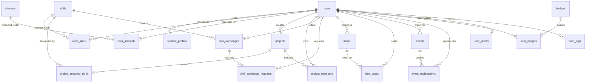

# 🎓 Campus Nexus — Student Collaboration Hub
### *Student Innovation, Teaming & Peer Mentorship Platform*

[](https://campus-nexus-1dc2.onrender.com)
[](https://www.php.net/)
[](Dockerfile)
[](https://www.mysql.com/)
[](https://render.com)
[](css/style.css)
[](LICENSE)

> 🚀 **Live Production Deployment:** [https://campus-nexus-1dc2.onrender.com](https://campus-nexus-1dc2.onrender.com)  
> *"Your Campus. Your Ideas. Your Future."* — An all-in-one, full-stack student collaboration platform engineered to break down academic silos across university departments.

---

## 📌 Table of Contents
- [Live Demo & Quick Links](#-live-demo--quick-links)
- [System Overview & Architecture](#-system-overview--architecture)
- [Key Features & Modules](#-key-features--modules)
- [Design Aesthetics & Visual Identity](#-design-aesthetics--visual-identity)
- [Technology Stack](#-technology-stack)
- [Database Schema & Architecture](#-database-schema--architecture)
- [Environment Variables](#-environment-variables)
- [Project Directory Structure](#-project-directory-structure)
- [Cloud Deployment (Render)](#-cloud-deployment-render)
- [Local Development & Docker Setup](#-local-development--docker-setup)
- [Security Implementation](#-security-implementation)
- [Manual Testing Checklist](#-manual-testing-checklist)
- [Roadmap & Future Enhancements](#-roadmap--future-enhancements)
- [License](#-license)

---

## 🌐 Live Demo & Quick Links

| Resource | Link / Details |
|---|---|
| **Production URL** | [https://campus-nexus-1dc2.onrender.com](https://campus-nexus-1dc2.onrender.com) |
| **Hosting Platform** | [Render](https://render.com) (Containerized via Docker on Linux) |
| **Runtime Environment** | Apache 2.4 + PHP 8.2 (`php:8.2-apache`) |
| **Database Engine** | Cloud MySQL 8.0 with InnoDB Storage Engine |
| **Source Repository** | [github.com/Vedantshah1230/Campus-Nexus](https://github.com/Vedantshah1230/Campus-Nexus) |

---

## 💡 System Overview & Architecture

### The Academic Silo Problem
In higher education institutions, student innovation is fragmented across chaotic WhatsApp groups, buried Discord channels, unread emails, and physical notice boards:
- Engineering students lack UI/UX designers or data analysts for hackathons.
- Students proficient in niche frameworks lack an organized way to mentor peers.
- Student initiatives and campus workshops struggle with manual seat registration and communication.

### The Nexus Solution
**Campus Nexus** bridges university departments into a centralized, high-performance web ecosystem:
1. **Algorithmic Team Matchmaking:** Calculates real-time skill-compatibility percentages between applicants and project technical requirements.
2. **Peer-to-Peer Skill Exchange:** Students offer mentorship in specific technologies and exchange 1-on-1 coaching requests.
3. **Democratic Campus Idea Board:** Transparent student proposal forum with vote tracking, category filters, and anti-self-vote server guards.
4. **Workshop & Event Discovery:** Real-time seat availability countdowns, registration caps, and status tracking.
5. **Idempotent Gamification:** Action-triggered points and achievement badges, complete with a campus leaderboard and podium spotlight.
6. **Institutional Identity Portal:** Dual-identifier authentication (Institutional Email or Roll Number) paired with an immutable security audit log (`auth_logs`).

---

## 🚀 Key Features & Modules

### 1. Animated Cosmic Landing Page (`public/index.php`)
- **Celestial Canvas & Ambient Halo:** Deep cosmic navy canvas (`#070a13`), dynamic interactive particle stars, and smooth atmospheric radial glows.
- **Problem vs. Solution Matrix:** Compares fragmented college communication with the structured Nexus workflow.
- **Interactive Match Simulator:** Live visual widget demonstrating how skill-compatibility scores are computed.
- **Gamification Showcase:** Previews unlockable badges and platform telemetry.

### 2. High-Density Unified Dashboard (`public/dashboard.php`)
- **Aggregated Metric Cards:** 8 real-time student statistics computed in a single optimized relational query:
  - Total Experience Points ⭐
  - Badges Unlocked 🏆
  - Projects Created & Joined 🚀
  - Pending Incoming Team Requests 📬
  - Skill Offers & Requests 🤝
  - Registered Upcoming Workshops 📅
- **Quick-Action Panel:** Instant shortcuts to launch projects, post ideas, offer mentorship, or browse events.

### 3. Student Profile & Skill Matrix (`modules/students/`)
- **Institutional Identity:** Department, semester, roll number, bio, and student initials avatar.
- **Skill Proficiency Matrix:** Standardized skill catalog (`Web Development`, `Programming`, `Database`, `Design`, `Security`) with proficiency levels (`Beginner`, `Intermediate`, `Advanced`, `Expert`).
- **Interests Matrix:** Transaction-guarded multi-select interest chips for personalized discovery.

### 4. Team Finder & Matchmaking (`modules/projects/`)
- **Compatibility Scoring:** Evaluates the student's logged skills against project requirements:
  $$\text{Match } \% = \left(\frac{\text{Matching Skills Count}}{\text{Total Required Skills Count}}\right) \times 100$$
- **Request Lifecycle:** Students apply to teams; project owners review applicants, inspect matched skills, and accept or reject with idempotent database transactions.

### 5. Peer Skill Exchange (`modules/skills/`)
- **Skill Offerings:** Students publish topics they are willing to teach or mentor.
- **Mentorship Requests:** Peers request 1-on-1 assistance with custom messages and contact preferences.
- **Ownership Security:** Students cannot request mentorship on their own offers; only the offering owner can accept/reject.

### 6. Campus Idea Board (`modules/ideas/`)
- **Democratic Proposals:** Students pitch projects, campus initiatives, and research ideas.
- **Search & Sort:** Filter proposals by search query, category, vote count (*Most Popular*), or creation date (*Newest*).
- **Anti-Tamper Voting:** Server-side verification preventing double-voting and self-voting on owned ideas.

### 7. Campus Events Discovery (`modules/events/`)
- **Live Seat Tracking:** Real-time remaining seats calculation (`max_participants - registered_count`).
- **Capacity Integrity:** Transactional concurrency checks prevent over-booking past event capacity.
- **Status Classification:** Automatic labeling of events as `Upcoming`, `Ongoing`, `Full`, or `Cancelled`.

### 8. Gamification & Leaderboard (`modules/gamification/`)
- **Verifiable Badges:** `First Project`, `Team Builder`, `Skill Sharer`, `Idea Contributor`, and `Event Explorer`.
- **Top 3 Podium Spotlight:** Visual gold (🥇), silver (🥈), and bronze (🥉) rankings highlighting top student contributors.
- **Campus Leaderboard:** Full campus standings including students starting with zero points.

### 9. Institutional Security & Audit Trail (`modules/auth/`)
- **Dual Identifier Login:** Students can authenticate using either their institutional email or their assigned university roll number.
- **Security Audit Telemetry:** Every authentication event (`LOGIN_SUCCESS`, `LOGIN_FAILED`, `REGISTRATION`, `LOGOUT`) logs user ID, IP address, user agent, and timestamp to `auth_logs`.

---

## 🎨 Design Aesthetics & Visual Identity

Campus Nexus employs a cohesive synthesis of modern web aesthetics:
- **Cinematic Deep Navy:** (`--cosmic-950: #070a13`, `--cosmic-900: #0b1120`) creates high-contrast depth for hero and dark accents.
- **Warm Pastel Peach & Cream:** (`--surface-cream: #fcfaf6`, `--peach-500: #f97316`) provides an inviting, accessible educational feel across content cards and forms.
- **Modern Clean Slate:** (`--background: #f8fafc`, `--surface: #ffffff`) ensures optimal readability and data density in dashboard views.
- **Typography:** Google Fonts pairing of **Plus Jakarta Sans** (clean, legible body copy) and **Space Grotesk** (tech-forward display headings).
- **Micro-Interactions:** Pure CSS subtle hover elevations, smooth transitions (`cubic-bezier(0.16, 1, 0.3, 1)`), and native `IntersectionObserver` scroll reveals.
- **Accessibility:** Full keyboard navigability, clear focus rings, and complete respect for `@media (prefers-reduced-motion: reduce)`.

---

## 🛠 Technology Stack

| Layer | Technology | Details |
|---|---|---|
| **Hosting Platform** | [Render](https://render.com) | Linux containerized Web Service with automated GitHub CI/CD deployments. |
| **Container Engine** | Docker | Multi-stage Apache + PHP 8.2 image with `mod_rewrite` enabled. |
| **Backend Runtime** | PHP 8.2 | Native, high-performance PHP without heavy framework overhead. |
| **Database** | MySQL 8.0 / MariaDB | Relational InnoDB storage engine, foreign keys, cascading deletes, unique constraints. |
| **Frontend Structure** | HTML5 | Clean semantic markup (`<main>`, `<nav>`, `<article>`, `<section>`, `<header>`, `<footer>`). |
| **Frontend Styling** | Vanilla CSS3 | Custom Properties (CSS variables), CSS Grid, Flexbox, zero Tailwind/Bootstrap dependencies. |
| **Client Scripting** | Vanilla JavaScript (ES6+) | Native DOM manipulation, custom canvas animation, ARIA attributes, and `IntersectionObserver`. |
| **Session & Auth** | PHP Native Sessions | Cookie security flags, session fixation protection, flash message bus, institutional audit trail. |

---

## 🗄 Database Schema & Architecture

The system database consists of **19 interconnected relational tables**:



### Table Summary:
1. `users` — Student accounts, email, role (`student`, `admin`), `last_login_at`, and bcrypt password hashes.
2. `student_profiles` — Academic metadata (department, semester, `roll_number`, bio, avatar).
3. `skills` — Standardized skill taxonomy with categories.
4. `user_skills` — Pivot table storing student skills and proficiency rankings.
5. `interests` — Catalog of student interest domains.
6. `user_interests` — Pivot table mapping users to interest tags.
7. `projects` — Student collaboration projects with status flags (`open`, `in_progress`, `completed`).
8. `project_required_skills` — Required technologies for algorithmic team compatibility.
9. `project_members` — Team membership applications and approval status (`pending`, `accepted`, `rejected`).
10. `skill_exchanges` — Peer teaching offerings.
11. `skill_exchange_requests` — Peer mentorship applications with status.
12. `ideas` — Innovation pitches with category and active status.
13. `idea_votes` — Unique composite key (`idea_id`, `user_id`) preventing double voting.
14. `events` — Campus workshops, date, location, and maximum seating capacity.
15. `event_registrations` — Unique composite key (`event_id`, `user_id`) tracking attendance.
16. `badges` — Achievement definition catalog with point values and criteria.
17. `user_badges` — Composite key (`user_id`, `badge_id`) ensuring badges are awarded exactly once.
18. `user_points` — Aggregated student point score with `ON DUPLICATE KEY UPDATE` handling.
19. `auth_logs` — Institutional access & audit trail (login attempts, successes, registrations, logouts with IP and device telemetry).

---

## ⚙️ Environment Variables

Campus Nexus dynamically loads database and server configuration via environment variables ([config/database.php](config/database.php)), falling back to local defaults if unspecified:

| Variable | Description | Default | Production Example (Render) |
|---|---|---|---|
| `DB_HOST` | MySQL database host / hostname | `localhost` | `gateway01.us-east-1.prod.aws.tidbcloud.com` |
| `DB_PORT` | MySQL database connection port | `3306` | `4000` (or `3306`) |
| `DB_NAME` | Database schema name | `campus_nexus` | `campus_nexus` |
| `DB_USER` | MySQL database user | `root` | `xxxxxx.root` |
| `DB_PASS` | MySQL database password | `123456` | *(Strong generated secret)* |
| `DB_SSL_CA` | Optional CA certificate file path for TLS/SSL | `null` | `/etc/ssl/certs/ca-certificates.crt` |
| `PORT` | Web server listening port for routing | `80` | `80` |

---

## 📁 Project Directory Structure

```
Campus-Nexus/
├── .dockerignore                   # Docker build exclusions
├── .gitignore                      # Git exclusion rules
├── Dockerfile                      # Production container spec (PHP 8.2 + Apache)
├── LICENSE                         # MIT License
├── README.md                       # Master documentation & deployment guide
├── index.php                       # Root request handler (redirects to public/)
├── vercel.json                     # Serverless deployment configuration
├── api/
│   └── index.php                   # Serverless runtime entrypoint
├── config/
│   ├── database.php                # Active database connection (reads env vars)
│   └── database.example.php        # Configuration reference template
├── css/
│   └── style.css                   # Master Design System (Cosmic + Student Portal)
├── database/
│   └── campus_nexus.sql            # Complete database schema and seed data
├── images/                         # Official logos, favicons, and graphic assets
├── includes/
│   ├── auth_logger.php             # Institutional audit & security logging service
│   ├── header.php                  # Global dynamic navigation, breadcrumbs & flash alerts
│   └── footer.php                  # Global 3-column footer & deferred script loader
├── js/
│   └── main.js                     # Vanilla mobile drawer toggle, alert dismissal & scroll reveal
├── modules/
│   ├── auth/                       # Institutional portal, dual-identifier login, registration
│   ├── students/                   # Profile view, editing, skills, and interests matrix
│   ├── projects/                   # Team finder, project creation, join requests & management
│   ├── skills/                     # Peer skill exchange offers and mentorship requests
│   ├── ideas/                      # Community idea board with anti-tamper voting & filters
│   ├── events/                     # Campus event discovery, seat count & registration
│   └── gamification/               # Badges catalog, idempotent helpers & campus leaderboard
└── public/
    ├── index.php                   # Animated landing page
    ├── dashboard.php               # High-density student analytics dashboard
    └── test-users.php              # Diagnostic test user inspection script
```

---

## ☁️ Cloud Deployment (Render)

The project is deployed on **Render** as a Docker Web Service. Follow these instructions to deploy your own instance or replicate the production environment:

### 1. Database Provisioning
1. Create a free MySQL database on [TiDB Cloud](https://tidbcloud.com) or [Aiven](https://aiven.io).
2. Open the SQL editor on your cloud database.
3. Import [database/campus_nexus.sql](database/campus_nexus.sql) to create all tables and initial badge/skill seeds.

### 2. Create Render Web Service
1. Log in to [Render Dashboard](https://dashboard.render.com).
2. Click **New +** → **Web Service**.
3. Connect your GitHub repository (`Campus-Nexus`).
4. Set the following configuration:
   - **Name:** `campus-nexus`
   - **Environment:** `Docker` (Render automatically uses the repository's `Dockerfile`)
   - **Branch:** `main`
   - **Region:** Any preferred region (e.g., Singapore, Frankfurt, Oregon)
   - **Instance Type:** `Free`

### 3. Add Environment Variables on Render
Under the **Environment Variables** tab of your Render service, add:
- `DB_HOST` = `<your-cloud-db-host>`
- `DB_PORT` = `3306` (or `4000` for TiDB)
- `DB_NAME` = `<your-db-name>`
- `DB_USER` = `<your-db-user>`
- `DB_PASS` = `<your-db-password>`
- `PORT` = `80`

### 4. Deploy
Click **Create Web Service**. Render will automatically build the container and launch Apache. Your application will be live at:
```
https://<your-service-name>.onrender.com
```

---

## 💻 Local Development & Docker Setup

### Option A: Using Docker (Recommended)
You can run the identical containerized environment locally with Docker:

```bash
# 1. Build the Docker container image
docker build -t campus-nexus .

# 2. Run the container locally mapping port 80
docker run -d -p 8080:80 \
  -e DB_HOST="host.docker.internal" \
  -e DB_PORT="3306" \
  -e DB_NAME="campus_nexus" \
  -e DB_USER="root" \
  -e DB_PASS="your_local_password" \
  --name campus-nexus-app campus-nexus

# 3. Access in your browser
# Open: http://localhost:8080
```

### Option B: Using XAMPP / WAMP / Native Apache
1. Clone or copy the project into your local server root (e.g. `C:\xampp\htdocs\campus-nexus\Campus-Nexus`).
2. Start Apache and MySQL from the XAMPP Control Panel.
3. Open `http://localhost/phpmyadmin`, create database `campus_nexus`, and import `database/campus_nexus.sql`.
4. Open `config/database.php` and verify your local credentials.
5. Open `http://localhost/campus-nexus/Campus-Nexus/public/index.php` in your browser.

---

## 🔒 Security Implementation

1. **SQL Injection Defense:** All user inputs in database queries are parameterized using `mysqli::prepare` and `bind_param`. No concatenated raw SQL strings.
2. **Cross-Site Scripting (XSS) Prevention:** All dynamic variables rendered in HTML are sanitized through `htmlspecialchars($var, ENT_QUOTES, 'UTF-8')`.
3. **Cross-Site Request Forgery (CSRF) Protection:** State-changing forms generate cryptographically secure tokens (`bin2hex(random_bytes(32))`) validated on submission with timing-attack safe `hash_equals()`.
4. **Password Hashing:** Passwords are encrypted using PHP's native `password_hash($password, PASSWORD_DEFAULT)` utilizing strong bcrypt hashing.
5. **Session Fixation Defense:** Sessions are refreshed upon authentication and destroyed upon logout, clearing session cookies.
6. **Server-Side Authorization:** Every action verifying project join requests, skill approvals, or idea voting validates ownership on the server side — never trusting client inputs.
7. **Concurrency-Safe Registrations:** Event seat capacity checks are validated on the server to prevent race conditions from over-booking workshops.
8. **Institutional Audit Logging:** Authentication events and access records are stored in `auth_logs` for security tracking.

---

## 🧪 Manual Testing Checklist

| Test Case | Steps to Test | Expected Result |
|---|---|---|
| **Registration** | Register a new student at `/modules/auth/register.php`. | Account created, automatic login, student profile and user points initialized, redirected to dashboard with welcome flash. |
| **CSRF Validation** | Submit an edited profile with a manipulated CSRF token. | Submission rejected with error alert: *"Security validation failed"*. |
| **Skill Profiling** | Add skills with proficiencies at `/modules/students/skills.php`. | Skills appear on profile, existing skills update via `ON DUPLICATE KEY UPDATE`. |
| **Team Matching** | Create a project requiring `Python` & `MySQL`. Log in as a student with those skills. | Team Finder displays a calculated 100% compatibility badge. |
| **Prevent Self-Request** | Attempt to request your own skill exchange at `/modules/skills/request.php`. | Blocked with warning: *"You cannot request assistance on your own skill offer."* |
| **Anti-Double Vote** | Cast a vote on an idea at `/modules/ideas/index.php` and attempt to vote again. | Vote registered, button switches to *"Voted ✓"*; second vote rejected by unique DB constraint. |
| **Event Capacity** | Attempt registration on an event with 0 remaining seats. | Registration blocked with message: *"Event has reached maximum capacity."* |
| **Gamification** | Create first project, accept a member, and register for an event. | Badges unlocked in `/modules/gamification/badges.php`; points correctly incremented on leaderboard. |
| **Mobile Navigation** | Resize viewport to $< 880\text{px}$ and click hamburger toggle. | Mobile drawer smoothly toggles with proper ARIA attributes, closes on outside click or Escape key. |

---

## 🔮 Roadmap & Future Enhancements

- **Real-Time Instant Messaging:** WebSocket-powered direct messaging client for matched project teammates and mentors.
- **Automated Notifications:** SMTP/PHPMailer email dispatch queue for event reminders, team approvals, and mentorship responses.
- **University SSO Integration:** SAML 2.0 / OAuth2 support for Google Workspace for Education and Microsoft Azure AD.
- **Cloud Attachment Storage:** Direct-to-S3 profile avatar and project portfolio file uploads.

---

## 📄 License

Distributed under the **MIT License**. See [LICENSE](LICENSE) for more information.

---

<p align="center">
  <b>Campus Nexus</b> · <i>Innovate. Collaborate. Excel.</i><br>
  Live at <a href="https://campus-nexus-1dc2.onrender.com">campus-nexus-1dc2.onrender.com</a>
</p>
