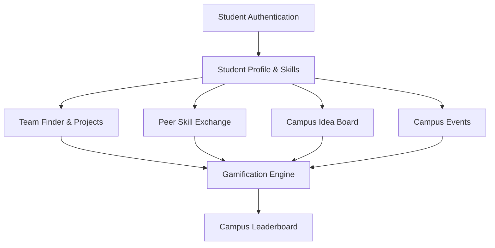

# 🎓 Campus Nexus — College Viva Voce & Demonstration Guide

> **Project Title:** Campus Nexus – Student Collaboration Hub  
> **Domain:** Full-Stack Web Application / Academic Collaborative Systems  
> **Core Technologies:** Native PHP 8.x, MySQL 8.x (InnoDB), HTML5, Vanilla CSS3, Vanilla JavaScript (ES6+)  
> **Architecture Pattern:** Modular MVC-lite / Service-oriented PHP Backend with Relational Integrity  

---

## 📋 Table of Contents
1. [5 to 8 Minute Live Demonstration Script](#1-5-to-8-minute-live-demonstration-script)
2. [Problem Statement & Project Objectives](#2-problem-statement--project-objectives)
3. [Walkthrough of Landing Page & Dashboard](#3-walkthrough-of-landing-page--dashboard)
4. [Step-by-Step Functional Modules Walkthrough](#4-step-by-step-functional-modules-walkthrough)
5. [PHP & MySQL Architecture & Data Relationships](#5-php--mysql-architecture--data-relationships)
6. [SQL Concepts & Database Optimization Used in Campus Nexus](#6-sql-concepts--database-optimization-used-in-campus-nexus)
7. [CSS Animation, Responsive Architecture & Accessibility](#7-css-animation-responsive-architecture--accessibility)
8. [Frequently Asked Viva Questions & High-Scoring Answers](#8-frequently-asked-viva-questions--high-scoring-answers)
9. [Known Limitations & Honest Future Scope](#9-known-limitations--honest-future-scope)
10. [Concise Portfolio Blurb for Resumes and LinkedIn](#10-concise-portfolio-blurb-for-resumes-and-linkedin)

---

## 1. 5 to 8 Minute Live Demonstration Script

Use this script during your final project evaluation or internal presentation. Each segment specifies **what to show on screen** and **the exact spoken talking points**.

| Time | On-Screen Action | Spoken Script / Talking Points |
|---|---|---|
| **0:00 - 1:00** | Open `public/index.php` (Landing Page). Slowly scroll through the Cosmic Hero, problem statement, and feature cards. | *"Respected evaluators, today I am presenting **Campus Nexus**, a centralized web platform designed to eliminate the fragmented nature of student collaboration in academic institutions. Currently, students rely on scattered messaging groups where project ideas get lost and peer skill-sharing is non-existent. Campus Nexus solves this through an integrated ecosystem covering algorithmic team matching, peer skill exchange, democratic idea voting, campus events, and gamified recognition. Notice our landing page uses a high-contrast cosmic design synthesized with accessible educational tokens, built entirely in pure Vanilla CSS and JavaScript with zero external frameworks."* |
| **1:00 - 2:00** | Navigate to `modules/auth/login.php` or `register.php`. Show form validation and log in with student account. Lands on `public/dashboard.php`. | *"Here we have secure student authentication. Passwords are encrypted using PHP's native `password_hash` with bcrypt. Notice the seamless transition to the student dashboard. In a single optimized SQL query, this dashboard computes 8 distinct metrics: current points, badges unlocked, active projects, pending join requests, skill offers, and registered events. This eliminates expensive redundant queries while offering students immediate situational awareness."* |
| **2:00 - 3:15** | Click **Profile** (`modules/students/profile.php`) and show Skills & Interests matrix (`modules/students/skills.php`). | *"Every student maintains a verified technical profile. Here, a student can declare skills categorized across Web, AI, Databases, and Design with specific proficiency levels. In the database, this leverages an `ON DUPLICATE KEY UPDATE` composite key pattern. Additionally, students select domain interest chips stored via database transactions. These skill profiles form the direct mathematical input to our project matchmaking engine."* |
| **3:15 - 4:30** | Click **Projects / Team Finder** (`modules/projects/team-finder.php`). Highlight the compatibility percentage badge (e.g. `100% Match`). Show project creation (`create.php`). | *"This is our Algorithmic Team Finder. When a student posts a project, they declare required skills. The system dynamically computes a compatibility score for every viewing student by cross-referencing required skills against their personal profile. Students can submit join requests with personalized notes. Project owners receive notifications, view matched competencies, and accept or reject applicants with instant transactional consistency."* |
| **4:30 - 5:45** | Visit **Skill Exchange** (`modules/skills/exchange.php`), then **Idea Board** (`modules/ideas/index.php`). Upvote an idea. | *"Next is our Peer Skill Exchange, which enables peer-to-peer tutoring. Students offer skills they excel in, and peers can request help. Built-in business logic strictly prevents self-requests and duplicate applications. On the Idea Board, students pitch innovations. Notice our anti-tamper voting mechanism: a student can only vote once per idea, verified via a composite primary key `(idea_id, user_id)`. Self-voting is blocked on the server, and the UI immediately reflects the voted state without breaking standard HTTP workflows."* |
| **5:45 - 6:45** | Visit **Campus Events** (`modules/events/index.php`) and **Leaderboard** (`modules/gamification/leaderboard.php`). | *"In Campus Events, students discover workshops with live remaining seat counts. When an event is full or in the past, registrations are safely locked server-side. Finally, our Gamification system tracks student engagement. Badges like 'First Project' and 'Team Builder' are awarded idempotently upon completing verified milestones. The Campus Leaderboard features a Top 3 Podium and ranks all contributors, fostering healthy collaborative competition."* |
| **6:45 - 7:30** | Conclude and open for questions. | *"To summarize, Campus Nexus delivers a robust, secure, and modern web application built with pure PHP 8 and MySQL. All database operations use prepared statements, CSRF protection is enforced across all forms, and the interface is fully responsive. Thank you, and I am now ready for your questions."* |

---

## 2. Problem Statement & Project Objectives

### Problem Statement
In higher education environments, student initiatives are hindered by:
1. **Information Fragmentation:** Critical notices, hackathon team requests, and workshops are scattered across ephemeral chat applications (WhatsApp, Telegram) with zero searchability or persistent tracking.
2. **Skill Asymmetry:** Junior students struggle to find accessible mentors, while senior students lack a formalized venue to share technical knowledge.
3. **Inefficient Teaming:** Forming multidisciplinary project teams (e.g., matching a backend developer with a UI/UX designer) relies on random word-of-mouth rather than verified skill requirements.
4. **Lack of Motivation & Feedback:** Extracurricular student contributions and peer assistance often go unrecognized by the wider campus community.

### Project Objectives
- **Centralize Collaboration:** Provide a unified web hub for student profiles, project building, peer learning, and event participation.
- **Implement Algorithmic Matching:** Compute and display dynamic skill-compatibility scores between students and open projects.
- **Ensure Data & Application Security:** Implement prepared SQL statements, timing-safe CSRF token verification, XSS sanitization, and strict server-side authorization checks.
- **Maintain High Performance & Zero Dependencies:** Build the entire platform using native PHP 8 and vanilla CSS3/JavaScript, avoiding bloated runtime frameworks.
- **Incentivize Peer Engagement:** Design an idempotent gamification engine with achievement badges, point accumulation, and a campus-wide leaderboard.

---

## 3. Walkthrough of Landing Page & Dashboard

### 1. Animated Landing Page (`public/index.php`)
- **Visual Design Strategy:** Uses a deep cosmic navy hero background (`--cosmic-950: #070a13`) layered with subtle radial gradients to create depth and modern technological appeal.
- **Interactive Match Simulation:** Displays a simulated project card demonstrating how the compatibility algorithm matches skills (e.g., `Python` + `Machine Learning` = `100% Match`).
- **Feature Ecosystem Grid:** 6 coordinated cards detailing Team Matching, Skill Marketplace, Idea Voting, Event Discovery, Gamification, and Student Profiles.
- **Dynamic Session Awareness:** The global header automatically detects login state. If logged in, calls to action redirect directly to `dashboard.php`; if guest, buttons prompt to `Sign In` or `Get Started`.

### 2. High-Density Analytics Dashboard (`public/dashboard.php`)
- **Data Densification:** Instead of sprawling empty space, the dashboard organizes key data into clean, elevated cards with subtle top accent gradients.
- **Single Optimized Metrics Query:** Computes 8 independent statistics in one database round-trip using subqueries:
```sql
SELECT
    (SELECT COALESCE(points, 0) FROM user_points WHERE user_id = ?) AS total_points,
    (SELECT COUNT(*) FROM user_badges WHERE user_id = ?) AS badges_count,
    (SELECT COUNT(*) FROM projects WHERE creator_id = ?) AS created_projects,
    (SELECT COUNT(*) FROM project_members WHERE user_id = ? AND status = 'accepted') AS joined_projects,
    (SELECT COUNT(*) FROM project_members pm JOIN projects p ON pm.project_id = p.id WHERE p.creator_id = ? AND pm.status = 'pending') AS pending_team_requests,
    (SELECT COUNT(*) FROM skill_exchanges WHERE user_id = ? AND status = 'open') AS open_skill_offers,
    (SELECT COUNT(*) FROM skill_exchange_requests ser JOIN skill_exchanges se ON ser.exchange_id = se.id WHERE se.user_id = ? AND ser.status = 'pending') AS pending_skill_requests,
    (SELECT COUNT(*) FROM event_registrations WHERE user_id = ? AND status = 'registered') AS registered_events;
```

---

## 4. Step-by-Step Functional Modules Walkthrough



### Module 1: Student Profiles & Skills (`modules/students/`)
- **Academic Fields:** Stores department, semester (validated 1–12), and bio.
- **Skills Matrix:** Multi-level skill assignment (`Beginner`, `Intermediate`, `Advanced`, `Expert`).
- **Database Query:** Uses `INSERT INTO user_skills (user_id, skill_id, proficiency) VALUES (?, ?, ?) ON DUPLICATE KEY UPDATE proficiency = VALUES(proficiency)`.

### Module 2: Team Finder & Project Creation (`modules/projects/`)
- **Creation Flow:** Project owner specifies title, detailed milestones, and checks required technologies.
- **Compatibility Algorithm:** Compares required skills in `project_required_skills` against the viewing student's `user_skills`.
- **Join Request Cycle:**
  1. Student sends join request (`status = 'pending'`).
  2. Project creator reviews candidate at `modules/projects/requests.php`.
  3. Creator approves (`status = 'accepted'`) or rejects (`status = 'rejected'`).
  4. Upon acceptance, the system triggers the **Team Builder** badge (+30 points) for the project creator.

### Module 3: Peer Skill Exchange (`modules/skills/`)
- **Offer Publishing:** Students post topics they are qualified to teach.
- **Mentorship Request:** Other students submit personalized learning requests.
- **Integrity Constraints:** Prevents students from requesting help on their own offers. Creator approves or declines requests; upon accepting, the **Skill Sharer** badge (+40 points) is awarded.

### Module 4: Idea Board with Voting (`modules/ideas/`)
- **Democratic Proposals:** Students pitch projects, campus initiatives, and research ideas.
- **Composite Key Voting:** `idea_votes` table uses `PRIMARY KEY (idea_id, user_id)` to guarantee physical database prevention of duplicate votes.
- **Server-Side Validation:** Blocks self-voting (creators cannot upvote their own ideas) and verifies active status.
- **Idempotent Gamification:** Creator receives the **Idea Contributor** badge (+20 points) on their first accepted proposal.

### Module 5: Campus Events (`modules/events/`)
- **Real-Time Seat Tracking:** Remaining seats computed dynamically as `max_participants - COUNT(event_registrations.id)`.
- **Capacity Enforcement:** If remaining seats $\le 0$, registration is rejected server-side.
- **Past Event Guard:** Compares `event_date < NOW()` to prevent registration for expired events.
- **Gamification Trigger:** Unlocks the **Event Explorer** badge (+20 points) upon first registration.

### Module 6: Gamification & Leaderboard (`modules/gamification/`)
- **Idempotency Control:** `awardBadge()` uses `INSERT IGNORE INTO user_badges` and checks `$stmt->affected_rows === 1` before calling `awardPoints()`. This ensures a student can never receive duplicate points for the same badge even if pages are reloaded.
- **Inclusive Leaderboard:** Uses `LEFT JOIN user_points` with `COALESCE(points, 0)` so all students, including newcomers with 0 points, are fairly visible on the leaderboard.
- **Podium Spotlight:** Top 3 students receive gold (🥇), silver (🥈), and bronze (🥉) podium cards with avatar initials and badge totals.

---

## 5. PHP & MySQL Architecture & Data Relationships

### Architectural Design
Campus Nexus adopts a clean, modular architecture:
- **`config/`:** Database credentials, environment configuration, and charset initialization.
- **`includes/`:** Global dynamic layout header (`header.php`) with subfolder-aware `$baseUrl` detection, breadcrumbs, session flash bus, and footer (`footer.php`).
- **`modules/`:** Discrete functional feature directories with isolated controllers and views.
- **`public/`:** Public entry points (`index.php`, `dashboard.php`).

### Dynamic Subfolder Resolution Standard
A major architectural feature of Campus Nexus is that it runs seamlessly on any server setup without hardcoded paths:
```php
$scriptDir = str_replace('\\', '/', dirname($_SERVER['SCRIPT_NAME'] ?? ''));
$detectedBase = preg_replace('~/(public|modules)(/.*)?$~i', '', $scriptDir);
$baseUrl = rtrim($detectedBase, '/');
```
Whether installed at `http://localhost/campus-nexus/Campus-Nexus/` or at a top-level domain `https://nexus.college.edu/`, all asset URLs (`/css/style.css`, `/js/main.js`) and navigation routes resolve accurately.

### Flash Message Bus Pattern
Rather than terminating requests with raw `die("error message")` calls that break application layouts, handlers store feedback in `$_SESSION['flash_success']`, `$_SESSION['flash_error']`, or `$_SESSION['flash_info']`, and redirect via `header("Location: ...")`. `header.php` renders accessible alert dismissals upon page arrival.

---

## 6. SQL Concepts & Database Optimization Used in Campus Nexus

During your viva, examiners frequently ask for specific examples of database concepts. Here are the exact implementations from Campus Nexus:

### 1. Primary Keys & Foreign Keys with Cascading Deletes
Every entity has a synthetic integer `AUTO_INCREMENT PRIMARY KEY`. Related tables enforce referential integrity with `ON DELETE CASCADE`:
```sql
CREATE TABLE `project_members` (
    `id` INT AUTO_INCREMENT PRIMARY KEY,
    `project_id` INT NOT NULL,
    `user_id` INT NOT NULL,
    `status` ENUM('pending', 'accepted', 'rejected') DEFAULT 'pending',
    FOREIGN KEY (`project_id`) REFERENCES `projects`(`id`) ON DELETE CASCADE,
    FOREIGN KEY (`user_id`) REFERENCES `users`(`id`) ON DELETE CASCADE
);
```
*Viva Explanation:* If a user or project is deleted, all corresponding join requests are automatically purged by the MySQL engine, preventing orphaned rows.

### 2. Composite Keys & Uniqueness Constraints
Used to prevent duplicate actions at the schema level:
```sql
-- Prevents a user from joining the same project multiple times
UNIQUE KEY `unique_project_member` (`project_id`, `user_id`);

-- Prevents a user from voting on the same idea multiple times
PRIMARY KEY (`idea_id`, `user_id`);

-- Prevents a user from registering for the same event multiple times
UNIQUE KEY `unique_event_registration` (`event_id`, `user_id`);
```

### 3. INNER JOIN vs. LEFT JOIN
- **INNER JOIN:** Used when data must exist on both sides (e.g. fetching only projects that have registered members):
```sql
SELECT p.title, u.name 
FROM project_members pm
INNER JOIN projects p ON pm.project_id = p.id
INNER JOIN users u ON pm.user_id = u.id;
```
- **LEFT JOIN:** Used when we want all records from the primary table even if related records don't exist yet (e.g., listing all students on the leaderboard even if they have 0 points):
```sql
SELECT users.id, users.name, COALESCE(user_points.points, 0) AS points
FROM users
LEFT JOIN user_points ON users.id = user_points.user_id
ORDER BY points DESC;
```

### 4. Aggregation & Subqueries
Used for counting active participants and remaining event seats:
```sql
SELECT 
    events.*,
    (SELECT COUNT(*) FROM event_registrations 
     WHERE event_registrations.event_id = events.id 
       AND event_registrations.status = 'registered') AS registered_count
FROM events;
```

### 5. `ON DUPLICATE KEY UPDATE`
Used in `modules/students/skills.php` and `modules/gamification/helpers.php` to handle upserts cleanly without extra read queries:
```sql
INSERT INTO user_points (user_id, points)
VALUES (?, ?)
ON DUPLICATE KEY UPDATE
    points = points + VALUES(points);
```

### 6. Prepared Statements & Parameter Binding
Protects 100% of queries against SQL Injection:
```php
$stmt = $conn->prepare("SELECT id, password FROM users WHERE email = ?");
$stmt->bind_param("s", $email);
$stmt->execute();
$result = $stmt->get_result();
```

---

## 7. CSS Animation, Responsive Architecture & Accessibility

### Design Token Architecture (`css/style.css`)
All colors, shadows, border radii, and transitions are organized as CSS Custom Properties in `:root`. This guarantees design uniformity across all 15+ pages.

### Fluid Typography & Layout
- Heading sizes utilize modern CSS clamp: `font-size: clamp(1.8rem, 4vw, 2.4rem);`, ensuring smooth scaling across 320px mobile screens and 4K displays.
- Responsive grids use auto-fit columns: `grid-template-columns: repeat(auto-fit, minmax(280px, 1fr));`.

### Micro-Interactions & Performance
- **Zero Heavy Libraries:** No jQuery, GSAP, or heavy animation frameworks.
- **Hardware-Accelerated Transitions:** Uses `transform` and `opacity` with cubic-bezier easing (`var(--ease-out): cubic-bezier(0.16, 1, 0.3, 1)`), avoiding layout recalculation (`reflow`).
- **Scroll Reveal via IntersectionObserver:** In `js/main.js`, native browser observers reveal cards as the user scrolls down, without expensive scroll event listeners.

### Accessibility & Reduced Motion
Campus Nexus strictly respects user accessibility preferences:
```css
@media (prefers-reduced-motion: reduce) {
    *, *::before, *::after {
        animation-duration: 0.01ms !important;
        animation-iteration-count: 1 !important;
        transition-duration: 0.01ms !important;
        scroll-behavior: auto !important;
    }
}
```
If a student has reduced motion enabled in their operating system, all floating animations and transforms are gracefully neutralized.

---

## 8. Frequently Asked Viva Questions & High-Scoring Answers

### Q1: Why did you build Campus Nexus in native PHP instead of Laravel or Node.js?
**High-Scoring Answer:**  
*"Building with native PHP allowed me to demonstrate core computer science and web engineering principles from first principles. Rather than relying on framework abstractions where ORM and routing magic hide backend operations, I implemented explicit SQL prepared statements, manual session management, custom CSRF protection, and a dynamic routing and base-URL resolution engine. It also results in a zero-dependency footprint that loads instantly on standard LAMP/WAMP server environments."*

---

### Q2: How do you prevent SQL Injection across the application?
**High-Scoring Answer:**  
*"We enforce parameterized prepared statements using MySQLi for every single dynamic query in the application. When a query is prepared, the SQL statement structure is parsed and compiled by the database server before user inputs are bound via `bind_param`. The database engine treats bound parameters strictly as literal data rather than executable SQL code, making SQL injection impossible regardless of input content."*

---

### Q3: How does your CSRF (Cross-Site Request Forgery) protection work?
**High-Scoring Answer:**  
*"Every user session generates a cryptographically secure random token using `bin2hex(random_bytes(32))`. When a state-changing form is rendered, this token is embedded as a hidden field. Upon form submission, the server verifies the submitted token against the session token using `hash_equals()`. We specifically use `hash_equals` instead of standard `===` to prevent timing attacks, ensuring third-party sites cannot submit unauthorized requests on behalf of an authenticated user."*

---

### Q4: How is password storage handled securely?
**High-Scoring Answer:**  
*"We use PHP's native `password_hash($password, PASSWORD_DEFAULT)`, which implements the bcrypt hashing algorithm with an automatically generated, cryptographically secure per-user salt and adaptive computational cost factor. During login, `password_verify()` evaluates the plaintext password against the stored hash in constant time."*

---

### Q5: How does the team matching algorithm calculate compatibility?
**High-Scoring Answer:**  
*"When a project is created, required skill IDs are stored in `project_required_skills`. When a student views the Team Finder, our backend queries the intersection of the student's logged skills with the project's required skills. The compatibility score is calculated as:*
$$\text{Match } \% = \left(\frac{|\text{Student Skills} \cap \text{Project Required Skills}|}{|\text{Project Required Skills}|}\right) \times 100$$
*This score is visually displayed as a color-coded percentage badge, allowing project creators and applicants to gauge compatibility immediately."*

---

### Q6: What prevents duplicate votes on the Idea Board?
**High-Scoring Answer:**  
*"We enforce two layers of protection. At the database layer, the `idea_votes` table defines a composite primary key: `PRIMARY KEY (idea_id, user_id)`. If an attempt is made to insert a second vote, MySQL rejects it with a key constraint violation. At the application layer, before inserting, the PHP handler checks if a vote record already exists, verifies that the user is not the creator of the idea, and renders an active voted state in the UI."*

---

### Q7: How does your gamification system ensure idempotency?
**High-Scoring Answer:**  
*"Idempotency means performing an action multiple times produces the same result as performing it once. In `modules/gamification/helpers.php`, when a milestone occurs, `awardBadge()` issues an `INSERT IGNORE INTO user_badges (user_id, badge_id)`. The composite primary key prevents duplicate entries. We then inspect `$stmt->affected_rows`. Only if `affected_rows === 1` (meaning a new badge was actually awarded for the first time) do we proceed to call `awardPoints()`. If a user refreshes the page or re-triggers an event, no additional points or duplicate badges are awarded."*

---

### Q8: How did you ensure the frontend works on mobile screens without Bootstrap?
**High-Scoring Answer:**  
*"We implemented a mobile-first responsive architecture using pure CSS Flexbox and CSS Grid with dynamic `minmax()` definitions. The navigation bar includes a pure vanilla JavaScript drawer toggle (`#navToggle`) that operates when screen width is $\le 880\text{px}$. The drawer is fully accessible: it toggles `aria-expanded`, traps focus, closes on outside clicks, and closes when the `Escape` key is pressed."*

---

## 9. Known Limitations & Honest Future Scope

In an academic defense, acknowledging limitations demonstrates maturity and deep understanding of system boundaries:

| Area | Current Implementation | Planned Future Enhancement |
|---|---|---|
| **Real-Time Chat** | Asynchronous request and approval workflow via database records. | Integration of WebSockets (Ratchet PHP or Socket.io) for live peer instant messaging. |
| **Notifications** | In-app session flash messages rendered on page arrival. | Automated background email dispatch (PHPMailer / SMTP) for request approvals and event reminders. |
| **Authentication** | Native email and password authentication. | University Single Sign-On (SSO) integration via OAuth2 / SAML / Google Workspace for Education. |
| **File Attachments** | Textual project descriptions and external link sharing. | Secure cloud file storage (S3-compatible) for student portfolio PDFs and project screenshots. |

---

## 10. Concise Portfolio Blurb for Resumes and LinkedIn

Use this concise description on your resume, LinkedIn project section, or GitHub repository summary:

> **Campus Nexus — Student Collaboration & Team Matchmaking Hub**  
> *Full-Stack Web Application (PHP 8, MySQL, Vanilla CSS3, JavaScript ES6)*  
> - Engineered an all-in-one student collaboration platform featuring algorithmic team matching, peer skill exchange, democratic idea voting, campus event discovery, and an idempotent gamification system.  
> - Designed an 18-table relational MySQL schema with cascading deletes, composite uniqueness constraints, and subquery-optimized dashboard metrics executing in a single database roundtrip.  
> - Implemented defense-in-depth security with parameterized prepared statements against SQLi, timing-attack safe CSRF validation, XSS sanitization, and password hashing via bcrypt.  
> - Built a zero-dependency frontend design system with custom CSS properties, fluid typography, responsive mobile drawer navigation, and full accessibility compliance (`prefers-reduced-motion`).
